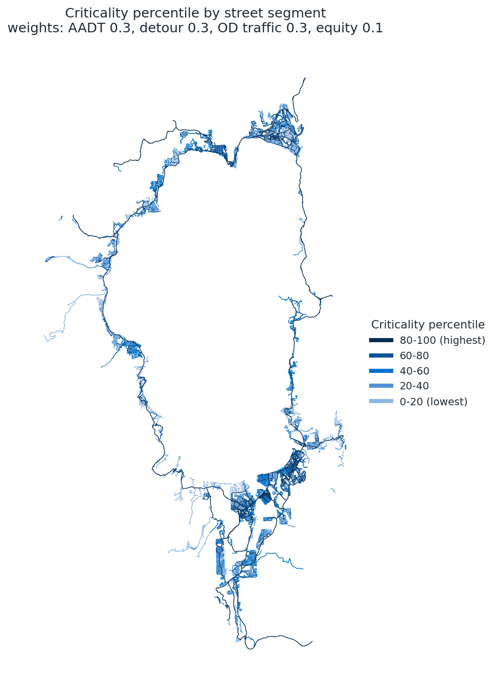
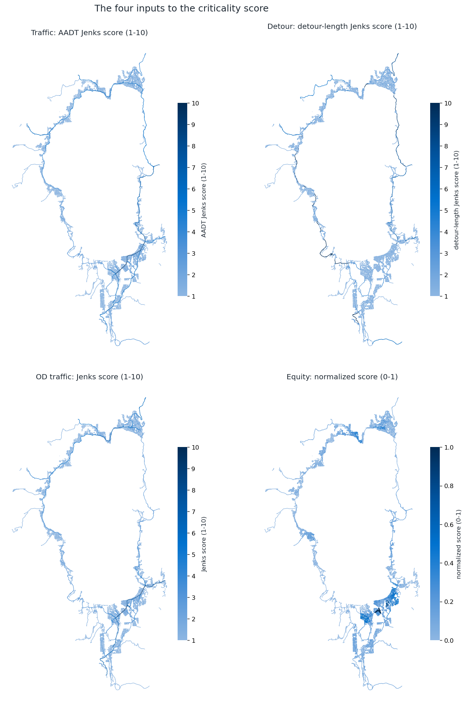
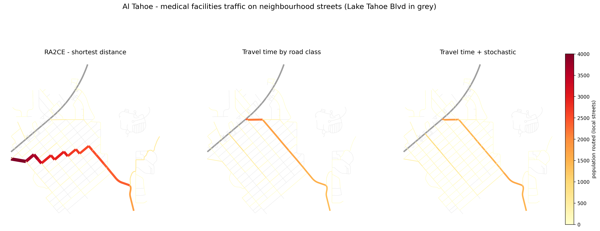
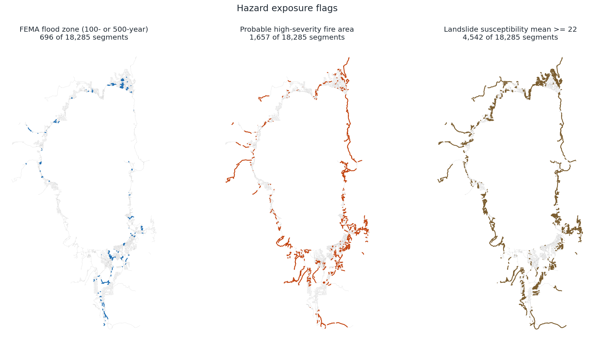

# Lake Tahoe Basin Street Network Criticality

**Part of:** PROTECT Task 3, Resilience Improvement Plan (Risk-Based Vulnerability Assessment)
**Prepared by:** Tahoe Regional Planning Agency (TRPA)
**Status:** Draft for review, October 2026

## Overview

To plan for wildfire, flooding, landslides and other hazards, the region needs to know which streets
matter most if they are damaged or closed. This dataset gives every drivable street segment in the Lake
Tahoe Basin a criticality score, along with the measures behind it and the hazards each street is exposed
to.

The dataset covers 18,285 street segments inside the basin. Each segment carries:

* **Hazard exposure:** whether it crosses a FEMA flood zone or an area of probable high-severity
  wildfire, and its landslide susceptibility.
* **Traffic volume:** modeled 2024 average annual daily traffic (AADT).
* **Detour length:** how much farther drivers would travel if the segment were closed.
* **Trips to critical destinations:** how many residents would use the segment to reach basin exits,
  law enforcement, medical facilities and emergency shelters.
* **Trips to everyday destinations:** the same measure for schools and fresh food locations.
* **Equity:** the needs of the surrounding neighborhoods, from census data.
* **Criticality score:** a weighted combination of the four measures above.

*Figure 1. Criticality across the basin, in five percentile classes. Darker blue streets score higher.*

## How to read the criticality score

The criticality score ranks how much a street matters to the basin's transportation system. It is
relative: a street in the top class (80-100) scores higher than at least 80% of the basin's streets.
Hazard exposure and physical condition are reported separately, so the risk index can combine them with
criticality.

The highest-scoring streets are the main highway corridors: US 50, Lake Tahoe Boulevard, Tahoe Boulevard
(SR 28), West Lake Boulevard (SR 89) and Kingsbury Grade (SR 207). These carry heavy traffic, are the routes residents use to reach
services and leave the basin, and have long detours when closed. Collector streets that connect
neighborhoods to those corridors form the next tier.

## What goes into the score

*Figure 2. The four measures that make up the criticality score.*

| Measure | What it captures | Weight |
|---|---|---|
| Traffic volume | How many vehicles use the street on an average day | 30% |
| Detour length | How far drivers would have to go around if the street were closed | 30% |
| Trips to destinations | How many residents depend on the street to reach exits, emergency services, schools and food | 30% |
| Equity | How many households nearby live below the poverty line, have no vehicle, have limited English, or include a person with a disability | 10% |

Traffic volume, detour length and trips are each sorted into 10 classes using natural breaks, a standard
method that groups similar values together. The four measures are then put on a common scale and combined
with the weights above.

### Traffic volume

Modeled 2024 AADT is assigned to each street it lines up with. Major roads that lack a modeled value take
the value of the connecting major road. Local and service streets without modeled volumes are treated as
carrying little traffic.

### Detour length

For each street, the analysis removes it from the network and finds the shortest remaining route between
its two ends. The extra distance of that route is the detour length. A long detour means closing the street
would cut off or greatly lengthen trips. Streets with no alternative at all, mostly dead ends and
driveways, are given the lowest detour score, since they serve few trips.

The detour analysis uses RA2CE, an open-source network resilience tool developed by Deltares, run on a
version of the street network that was corrected so that every road segment is represented.

### Trips to critical destinations

Each of 2,201 small hexagonal areas covering the basin sends its residents (about 54,000 in total) to six
types of destination:

| Destination | Count | How trips are assigned |
|---|---|---|
| Basin exits (highway routes out of the basin) | 7 | To the nearest exit |
| Law enforcement stations | 7 | To the nearest station |
| Medical facilities | 5 | Shared among facilities, with more trips to closer ones |
| Emergency shelters | 9 | Shared among shelters, with more trips to closer ones |
| Schools (K-12 and colleges) | 21 | Shared among schools, with more trips to closer ones |
| Fresh food locations (grocery stores, markets, farmers' markets) | 33 | Shared among locations, with more trips to closer ones |

Trips follow the quickest route, using typical speeds for each road type (for example 45 mph on major
highways, 30 mph on collectors and 25 mph on residential streets). To reflect that drivers do not all pick
the same route, the routing is repeated 100 times with small random variations in travel time, and the
results are averaged. Where two routes take about the same time, the trips are split between them.

The trip measure used in the criticality score is the average across all six destination types, so it
reflects both emergency access and everyday access to schools and food.

*Figure 3. Trips to medical facilities through the Al Tahoe neighborhood in South Lake Tahoe. Routing by
distance alone (left) sends the whole neighborhood along one zigzag of residential blocks. Routing by
travel time (center) moves those trips onto the collector streets, Sierra Boulevard, Martin Avenue and
O'Malley Drive. Adding route variation (right) spreads the remaining trips across the street grid. The
dataset uses the method on the right.*

### Equity

Each street takes the highest value from the census block groups it passes through for four household
counts: households below the poverty line, households with no vehicle, residents who speak English less
than well, and residents with a disability. The four are combined with equal weight. Trips to critical
destinations also carry a separate equity-weighted version (`prioritarian_*` fields), in which residents
of higher-poverty areas count more.

## Hazard exposure

*Figure 4. Streets flagged by each hazard layer.*

| Hazard | How a street is flagged | Streets |
|---|---|---|
| Flooding | Crosses a FEMA 100-year or 500-year flood zone | 696 |
| Flooding (100-year only) | Crosses a FEMA 100-year flood zone | 396 |
| Wildfire | Crosses an area with a higher probability of high-severity fire | 1,657 |
| Landslide | Average susceptibility along the street (0 to 81); 4,542 streets are at 22 or above | all streets have a value |

Hazard exposure is kept separate from criticality. The PROTECT risk index combines the two: a highly
critical street in a high-hazard area is a priority for resilience planning.

## Data sources

| Data | Source |
|---|---|
| Street network | Overture Maps Foundation open transportation data, processed into a routable network by TRPA |
| Flood zones | FEMA National Flood Hazard Layer |
| Wildfire severity | TRPA forest management zones and probable fire severity data |
| Landslide susceptibility | U.S. Geological Survey |
| Census demographics (equity, population) | U.S. Census Bureau American Community Survey, compiled by TRPA |
| Traffic volume | Modeled 2024 average annual daily traffic, licensed by TRPA |
| Basin exits, law enforcement, medical facilities, emergency shelters, schools, fresh food locations | TRPA |
| Network analysis software | RA2CE (Deltares), open source |

## Using the data

**Field guide.** The most useful fields are:

| Field | Meaning |
|---|---|
| `criticality_pctl` | Criticality percentile, 0 (lowest) to 100 (highest) |
| `criticality_score` | The underlying score (0 is the basin average) |
| `traffic_subindex`, `detour_subindex`, `od_subindex`, `equity_subindex` | The four measures on a common scale |
| `Estimated_2024_AADT_Filled` | Average daily traffic |
| `slr_diff_length_max` | Detour length in metres |
| `traffic_evacuation`, `traffic_law_enforcement`, `traffic_medical_facilities`, `traffic_emergency_shelters` | Residents routed over the street to each emergency destination type |
| `traffic_schools`, `traffic_fresh_food` | Residents routed over the street to schools and to fresh food locations |
| `in_flood_zone`, `in_flood_zone_100`, `high_sev_fire`, `landslide_mean` | Hazard exposure |

A full field dictionary, with the source and method for every field, accompanies the dataset.

**Keep in mind:**

* The score ranks streets within the Tahoe Basin only, so it applies to comparisons inside the basin.
* School and fresh food trips send every resident toward these destinations, with closer ones weighted
  more. Enrollment, attendance boundaries, residents' ages and store hours are outside the model, so these
  fields show how much each street matters for reaching schools and food, as a measure of access.
* Trip counts estimate how many basin residents depend on a street. Visitors, commuters from outside the
  basin and congestion effects are outside their scope; traffic volume (AADT) covers overall use.
* Road speeds are typical values by road type and are being reviewed with local partners.
* One-way streets and turn restrictions are not modeled.
* Where a street is long enough to cross several junctions, its trip values are an average along its
  length.
* This is a draft and values may change as inputs are reviewed.
